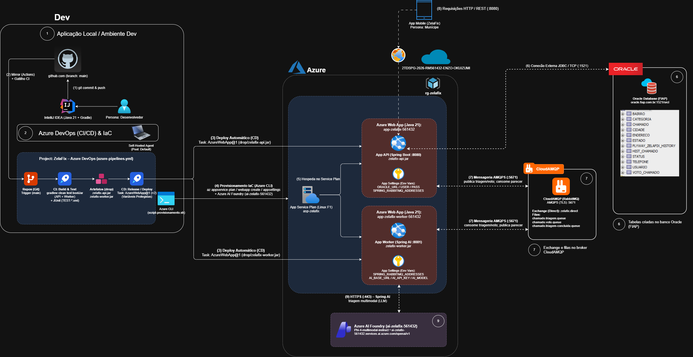

# 🏙️ ZelaFix Backend — DevOps Tools & Cloud Computing

> **FIAP — Global Solution 2026/2 | CitizenTech: Tecnologia com o Cidadão no Centro da Inovação (ODS 11)**  
> **Disciplina:** DevOps Tools & Cloud Computing  
> **Professor:** Antonio Sergio Rodrigues Figueiredo  
> **Arquitetura de Deploy:** Azure Web Apps PaaS (Linux) via Esteira Automatizada CI/CD Azure DevOps  
> **Opção Distribuída:** Microsserviços e Mensageria Assíncrona via RabbitMQ (CloudAMQP TLS)

<p align="left">
  
  
  
  
  
  
  
  
  
  
</p>

---

## 📌 Links Rápidos do Projeto

| Recurso | Descrição | Link |
|---|---|---|
| 🌐 **API em Produção (Azure Web App)** | Endpoint base do App Service da API REST (Plano F1 Linux - Porta 8080) | https://app-zelafix-561432.azurewebsites.net |
| 📖 **Swagger UI Interativo (Produção)** | Console OpenAPI interativo com documentação dos endpoints da API | https://app-zelafix-561432.azurewebsites.net/swagger-ui.html |
| 🩺 **Actuator Health (API)** | Healthcheck em tempo real da API (Oracle DB + Liveness) | https://app-zelafix-561432.azurewebsites.net/actuator/health |
| ⚙️ **Worker em Produção (Azure Web App)** | Host do Worker Assíncrono de Triagem Inteligente com Spring AI (Porta 8081) | https://app-zelafix-worker-561432.azurewebsites.net |
| 🩺 **Actuator Health (Worker)** | Healthcheck em tempo real do Worker (RabbitMQ + Azure AI Foundry Liveness) | https://app-zelafix-worker-561432.azurewebsites.net/actuator/health |
| 📊 **OpenAPI Spec (JSON)** | Especificação OpenAPI 3.0 para consumo do app Mobile | https://app-zelafix-561432.azurewebsites.net/v3/api-docs |
| 🚀 **Projeto no Azure DevOps** | Organização e Projeto Privado com Boards, Repos e Pipelines | https://dev.azure.com/ZelaFixGS/ZelaFix |
| 💻 **Repositório GitHub (DevOps)** | Repositório de IaC, Dockerfiles e scripts de automação | https://github.com/Global-Solution-CitizenTech/DevOps-Tools-Cloud-Computing |
| ☕ **Repositório GitHub (Java Advanced)** | Código-fonte da aplicação Spring Boot, Dockerfiles e suíte de testes | https://github.com/Global-Solution-CitizenTech/Java-Advanced |

---

## 🔗 Vídeo de Demonstração (Global Solution 2)

*(Link do YouTube será inserido após gravação)*

---

## 👥 Integrantes do Grupo

| RM | Nome Completo | Turma | Papel / GitHub |
| :---: | :--- | :---: | :--- |
| **RM561432** | Enzo Okuizumi Miranda de Souza | 2TDSPG | [EnzoOkuizumiFiap](https://github.com/EnzoOkuizumiFiap) |
| **RM563428** | Gustavo Keiji Okada | 2TDSPG | [Gdev3356](https://github.com/Gdev3356) |
| **RM566422** | Lucas Barros Gouveia | 2TDSPG | [LuzBGouveia](https://github.com/LuzBGouveia) |
| **RM562290** | Luna de Carvalho Guimarães | 2TDSPG | [lunaguima](https://github.com/lunaguima) |
| **RM564836** | Milton Jakson de Sousa Marcelino | 2TDSPG | [MiltonMarcelino](https://github.com/MiltonMarcelino) |

---

## 1. 📖 Descrição da Solução (Tema CitizenTech — ODS 11)

O **ZelaFix** é uma plataforma corporativa de **zeladoria urbana colaborativa** desenvolvida sob o paradigma **CitizenTech**, colocando o munícipe como agente ativo na fiscalização e melhoria contínua da infraestrutura urbana (buracos no asfalto, iluminação defeituosa, vazamentos e descarte irregular de lixo).

### Principais Pilares da Solução:
* **Canal Cidadão:** Abertura simplificada de ocorrências georreferenciadas com fotos e descrição detalhada.
* **Engajamento Comunitário:** Sistema de apoio e votos por munícipes da mesma região para priorização coletiva de chamados perante a administração pública.
* **Painel da Gestão Municipal:** Rastreabilidade do ciclo de vida dos chamados (`ABERTO`, `PENDENTE`, `EM_ANALISE`, `EM_EXECUCAO`, `CONCLUIDO`, `REJEITADO`) com histórico cronológico auditável.
* **Triagem Inteligente Desacoplada:** Triagem automatizada via LLM multimodal (Azure AI Foundry — `Phi-4-multimodal-instruct`) processada de forma assíncrona pelo microsserviço Worker via RabbitMQ, sem onerar a API REST nem o banco relacional.

### 🛠️ Stack Tecnológica & Decisões de Engenharia

| Componente | Tecnologia | Decisão de Arquitetura |
|---|---|---|
| **Linguagem & Runtime** | Java 21 LTS | Runtime corporativo oficial com virtual threads e alta performance |
| **Framework Base** | Spring Boot 4.1.1 | Ecossistema moderno com Spring Data JPA, Security, Actuator e Spring AI 2.0.1 |
| **Gerenciador de Build** | Gradle Multi-Project (Gradle 8.10) | Compilação e testes atômicos no CI em 1 comando; artefatos JAR isolados e desacoplados |
| **Banco de Dados Relacional** | Oracle Database 19c (FIAP Cloud) | 11 tabelas em 3ª Forma Normal (3FN), migrations automatizadas via Flyway |
| **Message Broker** | CloudAMQP (RabbitMQ TLS 5671) | Comunicação assíncrona de eventos na nuvem com plano gratuito Lemon |
| **Nuvem de Hospedagem** | Microsoft Azure App Service (Linux) | Host PaaS com plano **F1 (Free Tier)** para execução contínua sem custos |
| **Esteira de CI/CD** | Azure DevOps Pipelines | Automação completa: compilação, 186 testes unitários/integrados, artefatos e deploy |
| **Espelhamento Contínuo** | GitHub Actions (`mirror-to-azure.yml`) | Push no GitHub sincroniza imediatamente e automaticamente com o Azure Repos |
| **Agente de Execução** | Self-Hosted Agent (Windows) / Microsoft-Hosted | Pool `Default` dedicado para build e testes sem restrições de concorrência ou cotas |
| **Infraestrutura como Código (IaC)** | Azure CLI / Bash | Provisionamento declarativo e idempotente do Resource Group, Plan e Web Apps |
| **Containerização** | Docker Multi-Stage Build | Imagens leves baseadas em `eclipse-temurin:21-jre-alpine` com usuário não-root |

---

## 2. 🏛️ Arquitetura da Solução & Diagrama do Fluxo CI/CD

<p align="center">
  
</p>

> *Diagrama arquitetural completo gerado no Draw.io ([docs/gs2-zelafix-diagrama.drawio](./docs/gs2-zelafix-diagrama.drawio)) ilustrando o espelhamento GitHub ↔ Azure Repos, governança no Azure Boards, esteira CI/CD multi-service no Azure Pipelines, mensageria CloudAMQP TLS, persistência Oracle 19c e integração de visão multimodal com Azure AI Foundry (`phi-4-multimodal`).*

### 🔢 Descrição Detalhada das 10 Etapas da Esteira:

1. **Gatilho de Código & GitHub Actions:** O desenvolvedor realiza commits e pushes em uma branch vinculada a uma tarefa do **Azure Boards**. O workflow `.github/workflows/mirror-to-azure.yml` espelha o commit automaticamente para o **Azure Repos**.
2. **Políticas de Branch no Azure Repos:** A branch principal `main` é estritamente protegida: exige Work Item do Boards vinculado e aprovação de revisor antes de qualquer merge.
3. **Merge Aprovado na `main`:** Ao completar o Pull Request na `main`, o gatilho nativo (`individualCI`) do `azure-pipelines.yml` é disparado automaticamente.
4. **Alocação do Agente de Build:** O agente aloca o job em ambiente com JDK 21 e Gradle Wrapper.
5. **Compilação e Testes Automatizados:** O comando Gradle compila ambos os submódulos (`zelafix-api` e `zelafix-worker`), gera chaves RSA dinâmicas e executa os 186 testes automatizados JUnit 5.
6. **Publicação dos Testes:** A tarefa `PublishTestResults@2` lê os arquivos XML gerados e disponibiliza a aba nativa de relatórios de testes no Azure DevOps.
7. **Empacotamento e Publicação de Artefatos:** Os arquivos `zelafix-api.jar` e `zelafix-worker.jar` são consolidados no container de artefatos `'drop'` via `PublishBuildArtifacts@1`.
8. **Disparo do Estágio CD:** A etapa de Release é executada automaticamente mediante aprovação e sucesso total do estágio de Build.
9. **Deploy da API no Azure Web App:** A tarefa `AzureWebApp@1` realiza o deploy do `zelafix-api.jar` no Web App `app-zelafix-561432` na porta `8080`.
10. **Deploy do Worker no Azure Web App:** Em sequência atômica, a segunda tarefa `AzureWebApp@1` realiza o deploy do `zelafix-worker.jar` no Web App `app-zelafix-worker-561432` na porta `8081`.

---

## 3. ☁️ Banco de Dados em Nuvem (Requisito 08 & 10)

O backend utiliza o banco de dados corporativo **Oracle Database 19c** hospedado na infraestrutura da FIAP:

* **Host / Conexão:** `jdbc:oracle:thin:@//oracle.fiap.com.br:1521/orcl`
* **Schema / Usuário:** `RM561432`
* **Script DDL Oficial:** [`scripts/script-bd.sql`](./scripts/script-bd.sql) (DDL integral contendo 11 tabelas em 3ª Forma Normal, sequences e constraints conforme o Data Modeler `citizenTech.ddl`).
* **Migrations Automatizadas (Flyway):** Executadas na inicialização da API (`V1__criar_tabelas_zelafix.sql`, `V2__dados_iniciais_zelafix.sql` e `V3__admin_inicial.sql`), garantindo versionamento idempotente e seguro do banco.

---

## 4. ⚙️ Configuração do Projeto no Azure DevOps (Requisitos 01 a 06)

* **Visibilidade:** Projeto Privado (`Private`).
* **Processo de Trabalho:** `Agile` (Azure Boards integrado a Repos e Pipelines).
* **Políticas de Branch na `main` (Branch Policies):**
  - Número mínimo de revisores: 1 (com permissão para o autor aprovar seu próprio PR para fins de validação acadêmica).
  - Vinculação obrigatória de Work Item (nenhum código entra na `main` sem tarefa rastreada).
  - Revisor padrão configurado (RM do aluno responsável).
* **Acesso do Professor:**
  - *Nível da Organização:* **Basic**
  - *Nível do Projeto:* **Project Administrators**
* **Segurança e DevSecOps (Variáveis Protegidas):**
  - Credenciais de banco de dados (`ORACLE_PASSWORD`, `ORACLE_URL`, `ORACLE_USER`), token do RabbitMQ (`SPRING_RABBITMQ_ADDRESSES`) e chave da IA (`AI_API_KEY`) são cadastradas como **Secrets** mascarados nas variáveis da pipeline e no Application Settings dos Web Apps, sem exposição de texto puro no repositório Git.

---

## 5. 📜 Script de Provisionamento de Infraestrutura (Azure CLI)

O repositório disponibiliza o script automatizado [`scripts/script-provisionamento.sh`](./scripts/script-provisionamento.sh) em Bash utilizando o **Azure CLI** para criação e configuração declarativa e idempotente de toda a infraestrutura em nuvem:

```bash
# Execução no terminal com Azure CLI autenticado:
chmod +x scripts/script-provisionamento.sh
./scripts/script-provisionamento.sh
```

### Limpeza e Reconstrução (--clean):
```bash
./scripts/script-provisionamento.sh --clean
```

### 💡 Por que o Plano F1 (Free Tier) e como ele é configurado?
* **Custo Zero:** O plano `asp-zelafix` utiliza o SKU **F1** (Free Tier) Linux do Azure App Service, oferecendo 60 minutos de computação por dia e 1 GB de memória RAM compartilhada, sendo 100% gratuito e ideal para avaliações acadêmicas.
* **Compartilhamento de Plano:** Ambos os Web Apps (`app-zelafix-561432` e `app-zelafix-worker-561432`) rodam dentro do mesmo App Service Plan `asp-zelafix`, custando **R$ 0 adicionais**.
* **Otimização de JVM para F1:** Para evitar que o container Linux seja derrubado por limite de memória (*OOMKilled*), o script de provisionamento injeta automaticamente a configuração:
  ```bash
  JAVA_OPTS="-Xms256m -Xmx512m -XX:+UseG1GC -Djava.security.egd=file:/dev/./urandom"
  ```
* **Escalabilidade Imediata:** Caso seja necessário manter a aplicação com *Always On* contínuo durante a banca avaliadora, basta alternar para o SKU `B1` com um único comando:
  ```bash
  az appservice plan update --name asp-zelafix --resource-group rg-zelafix --sku B1
  ```

---

## 6. 🐳 Containerização com Docker (Multi-Stage Build)

O repositório conta com definições Docker otimizadas na pasta [`dockerfiles/`](./dockerfiles) para execução local ou em orquestradores de container:

* [`dockerfiles/Dockerfile.api`](./dockerfiles/Dockerfile.api): Imagem baseada em `eclipse-temurin:21-jre-alpine` expondo a porta `8080` com timezone `America/Sao_Paulo`.
* [`dockerfiles/Dockerfile.worker`](./dockerfiles/Dockerfile.worker): Imagem baseada em `eclipse-temurin:21-jre-alpine` expondo a porta `8081` para o worker assíncrono de IA.

*(No repositório do código Java, os Dockerfiles contam adicionalmente com multi-stage build com compilação Gradle e geração de chaves RSA em tempo de build).*

---

## 7. 🧪 Payloads JSON de Exemplo para Teste de CRUD

Abaixo constam os payloads representativos para execução das operações de **CRUD** nas entidades principais:

### A. Autenticação (`POST /auth/login`)
```json
{
  "email": "admin@zelafix.sp.gov.br",
  "senha": "admin"
}
```
*Retorna o token `Bearer eyJhbGciOiJSUzI1NiIsIn...` utilizado no header `Authorization` das requisições subsequentes.*

### B. CRUD de Usuários (`/usuarios`)
* **Create (`POST /usuarios`):**
  *(Nota de Segurança: O endpoint público sempre força o papel para `CIDADAO`, impedindo elevação de privilégios).*
  ```json
  {
    "nome": "Mariana Souza Santos",
    "email": "mariana.santos@email.com",
    "senha": "SenhaForte@2026",
    "cpf": "12345678909",
    "cargo": "CIDADAO",
    "telefone": {
      "ddd": 11,
      "numero": 987654321
    }
  }
  ```
* **Read (`GET /usuarios?page=0&size=10`):** Retorna lista paginada de munícipes cadastrados.
* **Update (`PUT /usuarios/2`):**
  ```json
  {
    "nome": "Mariana Souza Santos Atualizada",
    "email": "mariana.atualizada@email.com",
    "senha": "SenhaForte@2026",
    "cpf": "12345678909",
    "cargo": "CIDADAO",
    "telefone": {
      "ddd": 11,
      "numero": 999887766
    }
  }
  ```
* **Delete (`DELETE /usuarios/2`):** Remove o registro do usuário (bloqueado se houver chamados vinculados para preservar integridade referencial).

### C. CRUD de Chamados de Zeladoria (`/chamados`)
* **Create (`POST /chamados`):**
  *(Requisito obrigatório: envio com foto para análise da IA e comprovante urbano).*
  ```json
  {
    "titulo": "Buraco profundo na via pública",
    "descricao": "Buraco de grandes proporções no asfalto próximo ao cruzamento, causando risco iminente de acidentes para carros e motociclistas.",
    "idCategoria": 1,
    "latitude": -23.55052,
    "longitude": -46.633308,
    "logradouro": "Avenida Paulista",
    "numero": "1106",
    "bairro": "Bela Vista",
    "cidade": "São Paulo",
    "uf": "SP",
    "cep": "01311000",
    "urlFoto": "https://raw.githubusercontent.com/Global-Solution-CitizenTech/DevOps-Tools-Cloud-Computing/main/docs/rua-esburacada.png"
  }
  ```
* **Read (`GET /chamados?page=0&size=10&sort=dtAbertura,desc`):** Retorna ocorrências paginadas e ordenadas.
* **Update (`PUT /chamados/1`):**
  ```json
  {
    "titulo": "Buraco profundo na via pública (Risco Elevado)",
    "descricao": "Buraco aumentou de tamanho após as chuvas recentes, requer intervenção urgente da subprefeitura.",
    "idCategoria": 1,
    "latitude": -23.55052,
    "longitude": -46.633308,
    "logradouro": "Avenida Paulista",
    "numero": "1106",
    "bairro": "Bela Vista",
    "cidade": "São Paulo",
    "uf": "SP",
    "cep": "01311000",
    "urlFoto": "https://raw.githubusercontent.com/Global-Solution-CitizenTech/DevOps-Tools-Cloud-Computing/main/docs/rua-esburacada.png"
  }
  ```
* **Apoiar / Votar (`POST /chamados/1/apoiar`):** Registra o apoio da comunidade para priorização urbana (dispara evento para o RabbitMQ).
* **Delete (`DELETE /chamados/1`):** Cancela ou remove o chamado.

---

## 8. 📁 Estrutura de Arquivos deste Repositório

```text
DevOps-Tools-Cloud-Computing/
├── dockerfiles/
│   ├── Dockerfile.api                  # Dockerfile da API REST (Temurin 21 JRE Alpine)
│   └── Dockerfile.worker               # Dockerfile do Worker Assíncrono de IA (Temurin 21 JRE Alpine)
├── docs/                               # Diagramas, evidências e imagens de apoio
├── scripts/
│   ├── script-bd.sql                   # DDL oficial Oracle 19c com 11 tabelas em 3FN e constraints
│   └── script-provisionamento.sh       # Script Bash (Azure CLI) declarativo para provisionamento do RG, Plan, AI Foundry e Web Apps
├── azure-pipelines.yml                 # Definição oficial da esteira CI/CD (Build, Testes, Artefatos e Deploy)
└── README.md                           # Documentação técnica consolidada
```
